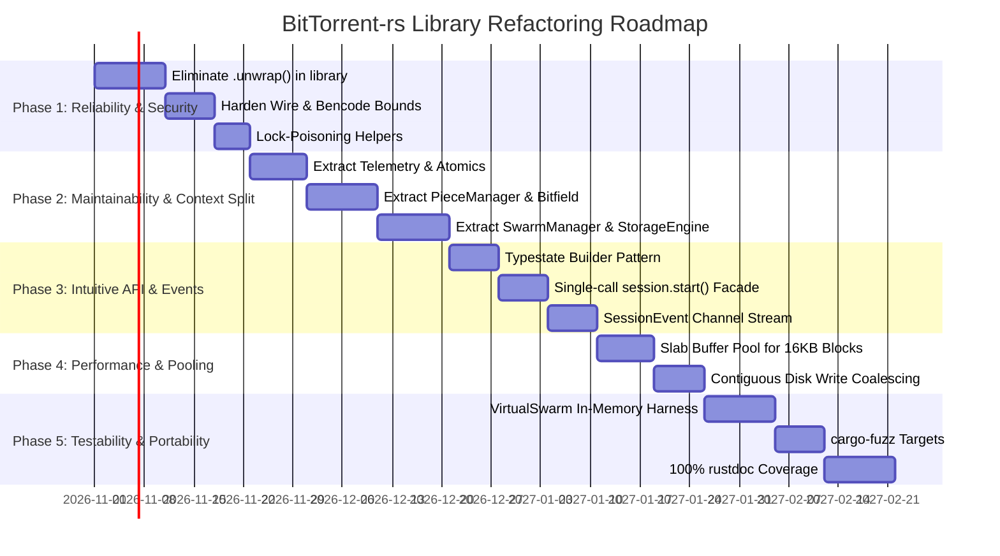

# Concrete Refactoring Plan: Implementing the 10 Attributes of High-Quality Software Libraries

This document presents a comprehensive, actionable refactoring plan for **`bittorrent-rs`** (`library/`) and its client integrations. The plan directly addresses the 10 core software library quality attributes defined in [`notes/ATTRIBUTES.md`](file:///c:/Projects/BitTorrent/notes/ATTRIBUTES.md), analyzing the current codebase, identifying architectural deficits, and specifying concrete phased code refactorings with precise interfaces, deliverables, and acceptance criteria.

---

## Executive Summary & Gap Analysis

```
                              THE 10 LIBRARY ATTRIBUTES
  ┌─────────────────────────────────────────────────────────────────────────────┐
  │ 1. Intuitive API       2. Comprehensive Docs    3. High Reliability        │
  │ 4. Performance         5. Maintainability       6. Flexibility/Extensible  │
  │ 7. Strong Security     8. High Testability      9. Portability/Compat      │
  │                        10. Low Dependency Footprint                         │
  └─────────────────────────────────────────────────────────────────────────────┘
                                       │
                      CONCRETE REFACTORING ROADMAP
  ┌─────────────────┬──────────────────┬─────────────────┬─────────────────────┐
  │ Phase 1:        │ Phase 2:         │ Phase 3:        │ Phase 4 & 5:        │
  │ Reliability &   │ Modularization & │ Intuitive API & │ Performance, Docs & │
  │ Security Hardening│ Context Split  │ Event Stream    │ Virtual Swarm Tests │
  └─────────────────┴──────────────────┴─────────────────┴─────────────────────┘
```

### Gap Analysis Matrix

| # | Attribute | Current Codebase State | Target State After Refactor | Primary Optimization Levers |
|---|---|---|---|---|
| **1** | **Intuitive API Design** | Multi-step manual tracker announcing & peer wiring; public field exposure in `TorrentContext`; `String`-based error variants. | Single-call facade (`session.start()?`); typestate builder (`TorrentSessionBuilder<Ready>`); granular typed `BitTorrentError`. | [`session.rs`](file:///c:/Projects/BitTorrent/library/src/session/session.rs), [`builder.rs`](file:///c:/Projects/BitTorrent/library/src/session/builder.rs), [`error.rs`](file:///c:/Projects/BitTorrent/library/src/utils/error.rs) |
| **2** | **Comprehensive Documentation** | Good high-level docs in `docs/`, but spotty `# Errors`, `# Panics`, and doc-tests on public structs/methods in `library/src/`. | 100% rustdoc coverage on all public items; runnable doc-tests; explicit threading & safety guarantees. | `#![warn(missing_docs)]`, [`lib.rs`](file:///c:/Projects/BitTorrent/library/src/lib.rs), all public interfaces |
| **3** | **High Reliability** | 29 files using `.unwrap()`; lock poisoning risks on `Arc<Mutex<TorrentContext>>`; unmanaged thread panics. | Zero `.unwrap()`/`.expect()` in non-test library code; poison-resilient lock helpers; supervisor pattern for worker threads. | [`worker.rs`](file:///c:/Projects/BitTorrent/library/src/session/worker.rs), [`torrent_context.rs`](file:///c:/Projects/BitTorrent/library/src/core/torrent_context.rs), error conversions |
| **4** | **Performance & Efficiency** | Coarse `TorrentContext` lock contention; 16 KiB `Vec<u8>` allocation churn; telemetry locks entire session context. | Lock-free atomic telemetry (`TransferMetrics`); slab-pooled 16 KiB piece buffers; contiguous disk write coalescing. | [`disk_cache.rs`](file:///c:/Projects/BitTorrent/library/src/storage/disk_cache.rs), [`transfer_metrics.rs`](file:///c:/Projects/BitTorrent/library/src/core/transfer_metrics.rs) |
| **5** | **Maintainability** | Monolithic `TorrentContext` (2,655 lines, 50+ fields); oversized files (`peer.rs` 62KB, `utp.rs` 60KB, `metainfo.rs` 61KB). | Decomposed into 5 cohesive sub-managers (`PieceManager`, `SwarmManager`, `StorageManager`, `MetadataManager`, `TelemetryManager`). | Sub-crate modularization, SRP refactor |
| **6** | **Flexibility & Customization** | Choking policy hardcoded; polling required to inspect state; discovery sources coupled to session builder. | Asynchronous `SessionEvent` channel (`mpsc`); pluggable `ChokingStrategy`, `PiecePicker`, and `PeerDiscoverySource` traits. | Event stream, traits in `io_traits.rs` and `session/` |
| **7** | **Strong Security** | Basic path traversal validation in `metainfo.rs`; unbounded wire message size checks; potential memory bomb in Bencode strings. | Strict wire frame limits (17 KiB max); bounded Bencode parsing depth/length; cryptographic timing-safe checks; peer request throttling. | [`peer_message.rs`](file:///c:/Projects/BitTorrent/library/src/network/peer_message.rs), [`bencode.rs`](file:///c:/Projects/BitTorrent/library/src/utils/bencode.rs) |
| **8** | **High Testability** | Good unit/integration tests, but multi-peer swarm tests require loopback or manual `MockSocket` plumbing. | First-class `VirtualSwarm` test harness enabling multi-peer transfers in-memory in <100ms; `cargo-fuzz` harnesses for parsers. | [`library/tests/`](file:///c:/Projects/BitTorrent/library/tests), `VirtualSwarm`, fuzz targets |
| **9** | **Compatibility & Portability** | `#![no_std]` partially present; platform-specific path and socket options; CI matrix lacks comprehensive cross-platform testing. | Strict `#![no_std]` core crate boundary; portable cross-platform I/O layer; Windows, Linux, macOS CI matrix. | Platform abstractions, GitHub Actions matrix |
| **10** | **Low Dependency Footprint** | Low baseline (`sha1`), but features activate heavy optional crates (`ureq`, `serde_json`) even when not strictly needed. | Granular feature flags (`minimal`, `std`, `dht`, `webtorrent`, `v2`); zero mandatory dependencies beyond `sha1`. | [`library/Cargo.toml`](file:///c:/Projects/BitTorrent/library/Cargo.toml) feature trees |

---

## Attribute 1: Intuitive API Design

### Problem Statement
Currently, getting started with `bittorrent-rs` requires orchestrating multiple disconnected types and manual method calls:
```rust
// Current cumbersome workflow:
let mut session = TorrentSession::builder(path, dir).build()?;
session.start_download()?;
let mut tracker = Tracker::new(session.context())?;
let announce_response = tracker.start_announcing()?;
session.download_from_peers(announce_response.peer_list)?;
```
Furthermore, the session context (`Arc<Mutex<TorrentContext>>`) exposes raw mutable collections (`files_to_download`, `bitfield`, `piece_data`) directly, forcing library consumers to understand internal protocol synchronization details.

### Action Plan & Architecture
1. **High-Level Facade (`TorrentSession::start()`)**:
   Implement an automated lifecycle runner on `TorrentSession`. When called, `start()` spawns and coordinates background peer discovery (Trackers, DHT, PEX, LSD) and downloads according to `SessionConfig`, without requiring manual multi-step plumbing.
2. **Typestate Pattern in `TorrentSessionBuilder`**:
   Guarantee compile-time correctness of session initialization:
   ```rust
   pub struct TorrentSessionBuilder<State = Initial> {
       source: TorrentSource,
       download_path: PathBuf,
       config: SessionConfig,
       _marker: PhantomData<State>,
   }
   
   pub struct Initial;
   pub struct Ready;
   
   impl TorrentSessionBuilder<Initial> {
       pub fn new(source: impl Into<TorrentSource>, download_path: impl AsRef<Path>) -> TorrentSessionBuilder<Ready>;
   }
   
   impl TorrentSessionBuilder<Ready> {
       pub fn with_config(mut self, config: SessionConfig) -> Self;
       pub fn with_storage<S: BlockStorage + 'static>(mut self, storage: S) -> Self;
       pub fn build(self) -> Result<TorrentSession, BitTorrentError>;
   }
   ```
3. **Strongly Typed `BitTorrentError` Variants**:
   Replace unstructured `BitTorrentError::Parse(String)` and `Protocol(String)` with explicit, matchable enum variants implementing `std::error::Error` with `source()` chaining:
   ```rust
   #[derive(Debug, thiserror::Error)]
   pub enum BitTorrentError {
       #[error("I/O error: {0}")]
       Io(#[from] std::io::Error),
       #[error("Bencode decode error: {0}")]
       Bencode(#[from] BencodeError),
       #[error("Piece verification failed for piece {index} (hash mismatch)")]
       PieceHashMismatch { index: usize },
       #[error("Storage failure on file '{path}': {reason}")]
       Storage { path: String, reason: String },
       #[error("Tracker request failed: {0}")]
       Tracker(#[from] TrackerError),
       #[error("Peer wire protocol violation from {peer}: {reason}")]
       ProtocolViolation { peer: SocketAddr, reason: &'static str },
       #[error("Torrent session is shut down")]
       SessionClosed,
   }
   ```

---

## Attribute 2: Comprehensive Documentation

### Problem Statement
While high-level Markdown guides exist in `docs/`, inline API documentation in `library/src/` has significant gaps:
- Private methods lack comments explaining protocol preconditions.
- Public functions frequently omit `# Errors`, `# Panics`, and `# Examples` sections.
- Intra-doc links are rarely used, preventing seamless IDE code navigation.

### Action Plan & Architecture
1. **Enable `#![warn(missing_docs)]` in `library/src/lib.rs`**:
   Ensure every public struct, enum, trait, function, and constant is accompanied by descriptive rustdoc commentary.
2. **Standardize Doc Block Layout**:
   Every public API entry must strictly follow the standard Rust documentation structure:
   - **Summary**: Concise one-sentence synopsis.
   - **Detailed Description**: Protocol implications, BEP references (e.g. BEP 3, BEP 52).
   - **# Arguments**: Parameter types, validation rules, and default fallbacks.
   - **# Errors**: Explicit listing of all `BitTorrentError` variants that can be returned.
   - **# Panics**: Guarantee of panic freedom under normal conditions.
   - **# Example**: Compilable or `no_run` code sample showing idiomatic usage.
3. **Interactive Architectural Diagrams**:
   Embed mermaid state machine diagrams in `TorrentSession`, `TorrentStatus`, and `Peer` rustdocs documenting handshake and state transition lifecycles.

---

## Attribute 3: High Reliability

### Problem Statement
A codebase grep reveals **29 files in `library/src/` containing `.unwrap()` calls**, predominantly on mutex locks (`mutex.lock().unwrap()`), option unwrap, and slice index conversions. If any thread panics while holding an `Arc<Mutex<TorrentContext>>`, all remaining threads encounter poisoned locks and cascade-panic.

### Action Plan & Architecture
1. **Systematic `.unwrap()` Elimination**:
   Replace all occurrences of `.unwrap()` and `.expect()` in `library/src/` with structured error handling:
   - For mutexes: Implement a resilient lock helper:
     ```rust
     pub fn safe_lock<T>(mutex: &Mutex<T>) -> Result<MutexGuard<'_, T>, BitTorrentError> {
         mutex.lock().map_err(|_| BitTorrentError::LockPoisoned)
     }
     ```
   - For slice indexing: Replace raw `&bytes[..20]` with `bytes.get(..20).ok_or(...)` or safe fixed-size array conversions (`TryInto`).
2. **Worker Thread Supervision**:
   Wrap network and worker loops in supervisor handlers that catch panics using `std::panic::catch_unwind`, log diagnostic telemetry, cleanly disconnect faulty peers, and restart worker loops without terminating the entire `TorrentSession`.
3. **Structured Cooperative Shutdown**:
   Implement `CancellationToken` pattern across all background tasks (announcers, DHT listeners, peer workers, disk writers). On `session.stop()`, background tasks are notified and given a bounded grace period (e.g., 2.0s) to flush disk writes before joining threads.

---

## Attribute 4: Performance and Efficiency

### Problem Statement
1. **Lock Contention**: The coarse `TorrentContext` lock is contended by network peer workers, hash verification pools, disk flushes, and GUI/CLI status queries.
2. **Memory Allocation Churn**: Network message processing allocates new 16 KiB `Vec<u8>` buffers on every incoming piece block.
3. **Telemetry Polling**: Inspecting download speed or progress percent locks the entire context.

### Action Plan & Architecture
1. **Lock-Free Telemetry (`TransferMetrics`)**:
   Keep all telemetry metrics in atomic counters (`AtomicU64`, `AtomicU32`, `AtomicUsize`) updated via relaxed/acquire-release atomic operations. Client UI status polling reads these atomics directly without touching any mutex.
2. **Slab Buffer Pool for 16 KiB Blocks**:
   Introduce a thread-safe slab buffer pool (`BlockBufferPool`) with pre-allocated 16 KiB buffers. Network workers acquire a reusable buffer from the pool, fill it from the wire, hand it off to the disk cache, and return it to the pool upon disk write completion, achieving **0 memory allocations per block in steady state**.
3. **Contiguous Disk Write Coalescing**:
   Enhance `DiskCache` to group consecutive 16 KiB blocks of the same piece into a single contiguous disk `write_all()` call, reducing kernel system calls by up to 16x on fast NVMe/SSD storage.

---

## Attribute 5: Maintainability

### Problem Statement
`TorrentContext` in [`library/src/core/torrent_context.rs`](file:///c:/Projects/BitTorrent/library/src/core/torrent_context.rs) has swollen to **2,655 lines and 50+ fields**, serving as a classic God object. Similarly, `peer.rs` (62 KB), `utp.rs` (60 KB), and `metainfo.rs` (61 KB) suffer from excessive file complexity.

### Action Plan & Architecture
Decompose `TorrentContext` into 5 cohesive, independently testable domain managers:

```
                          ┌──────────────────────────┐
                          │      TorrentSession      │
                          └─────────────┬────────────┘
                                        │
           ┌──────────────┬─────────────┼──────────────┬──────────────┐
           ▼              ▼             ▼              ▼              ▼
    ┌─────────────┐┌─────────────┐┌─────────────┐┌─────────────┐┌─────────────┐
    │PieceManager ││SwarmManager ││StorageEngine││MetadataMgr  ││TelemetryMgr │
    ├─────────────┤├─────────────┤├─────────────┤├─────────────┤├─────────────┤
    │• Bitfield   ││• Peers Map  ││• DiskCache  ││• InfoDict   ││• Atomics    │
    │• Availability│• Choke State││• Verification│• MerkleTree ││• Speed Calc │
    │• Picker     ││• Reputation ││• File Map   ││• Layers     ││• ETA        │
    └─────────────┘└─────────────┘└─────────────┘└─────────────┘└─────────────┘
```

1. **`PieceManager`**: Bitfield tracking, piece availability across peers, rarest-first and sequential piece selection.
2. **`SwarmManager`**: Connected peers map, optimistic unchoking policy, PEX exchange, and bad peer reputation scores.
3. **`StorageEngine`**: File mapping, block read/write operations, multi-threaded hash verification, and fast-resume checkpointing.
4. **`MetadataManager`**: Magnet link BEP 9 extension metadata bootstrapping, info-hash validation, and BEP 52 v2 Merkle proof tree cache.
5. **`TelemetryManager`**: High-performance lock-free atomic counters for rates, totals, and swarm metrics.

---

## Attribute 6: Flexibility and Customization

### Problem Statement
Consumers currently have limited ways to customize library behavior:
- Piece selection algorithm is hardcoded or difficult to replace.
- There is no event stream for notifications (clients must poll the session context every N milliseconds).
- Storage and peer discovery mechanisms cannot easily be extended by third parties.

### Action Plan & Architecture
1. **Asynchronous `SessionEvent` Stream**:
   Provide a standard channel (`tokio::sync::mpsc` or crossbeam `Receiver<SessionEvent>`) that emits strongly typed notifications:
   ```rust
   pub enum SessionEvent {
       StateChanged(TorrentStatus),
       PieceCompleted { piece_index: usize, total_completed: usize, total_pieces: usize },
       FileCompleted { file_index: usize, path: String },
       PeerConnected { addr: SocketAddr, client: String },
       PeerDisconnected { addr: SocketAddr, reason: String },
       MetadataResolved { name: String, total_size: u64, files_count: usize },
       DownloadFinished,
       Error(BitTorrentError),
   }
   ```
2. **Pluggable Strategy Traits**:
   Expose clean extension interfaces:
   - `PieceSelector`: Define custom piece picking policies (e.g. streaming window lookahead, rarest-first, sequential).
   - `ChokingStrategy`: Implement custom tit-for-tat or round-robin unchoking algorithms.
   - `PeerDiscoverySource`: Add custom discovery mechanisms (e.g. custom HTTP APIs, mesh networks, or mDNS).
3. **Session Configuration Presets**:
   Provide ready-to-use presets on `SessionConfig`:
   - `SessionConfig::default()`: Balanced general-purpose desktop downloading.
   - `SessionConfig::fast_streaming()`: Sequential forward-window prioritization, aggressive buffer caching.
   - `SessionConfig::minimal_memory()`: Restricted slab buffer pool, zero disk caching, for embedded/NAS devices.
   - `SessionConfig::seedbox()`: Maximize connection counts, super-seeding enabled, multi-threaded disk hashing.

---

## Attribute 7: Strong Security

### Problem Statement
BitTorrent clients operate in an adversarial peer-to-peer environment. Key vulnerability vectors include:
1. **Memory Exhaustion via Wire Lengths**: Malformed peer wire messages declaring 2 GB payloads.
2. **Bencode Decompression/Recursion Bombs**: Malformed dictionaries nested hundreds of levels deep.
3. **Path Traversal Attacks**: Malicious torrent metainfo containing absolute paths, symlinks, or parent directory references (`../../etc/passwd`).
4. **Denial of Service via Request Spam**: Flooding the client with block requests to exhaust disk I/O.

### Action Plan & Architecture
1. **Strict Wire Protocol Frame Bounds**:
   Enforce hard boundaries in `peer_message.rs`:
   - Maximum wire frame length: 17 KiB (`16 KiB block + 9 byte header`). Any message specifying a greater length immediately results in peer termination.
   - Handshake timeouts: Peers failing to complete the BitTorrent handshake within 5.0 seconds are dropped.
2. **Bounded Bencode Parser**:
   Harden `bencode_tokenizer.rs` and `bencode.rs`:
   - Recursion depth limit: 64 nested levels max (reject with `BencodeError::NestingDepthExceeded`).
   - String length limit: Bencode strings capped at maximum metadata size (10 MB).
   - Integer length limit: String representations of integers capped at 20 characters.
3. **Hardened Path Sanitization**:
   Expand `validate_relative_path` to sanitize every file path component:
   - Reject null bytes, Windows alternate data streams (`:`), and reserved filenames (`CON`, `PRN`, `AUX`, `NUL`).
   - Verify that all canonicalized file targets reside strictly within `download_path` without following escaping symlinks.
4. **Peer Request Rate Limiting & Blacklisting**:
   Track inbound block requests per peer. If a choked or un-whitelisted peer spams more than 64 requests/sec, downgrade reputation and ban the IP address for 1 hour.

---

## Attribute 8: High Testability

### Problem Statement
Integration tests in `library/tests/` depend on concrete sockets or timing delays. Testing multi-peer swarm interactions, piece trading, and endgame cancellation requires heavyweight setups that slow down CI pipelines.

### Action Plan & Architecture
1. **In-Memory `VirtualSwarm` Test Harness**:
   Implement a `VirtualSwarm` test framework allowing N virtual peers and a virtual tracker to be instantiated in-memory:
   ```rust
   let swarm = VirtualSwarm::builder()
       .with_seed(torrent_data.clone())
       .with_leechers(3)
       .with_latency(Duration::from_millis(10))
       .build()?;
   
   swarm.run_until_complete(Duration::from_secs(5))?;
   assert_eq!(swarm.leecher(0).progress_percent(), 100.0);
   ```
   Runs entire end-to-end multi-peer swarms deterministically in **under 150 ms** without opening OS network ports.
2. **Fuzz Testing Targets (`cargo-fuzz`)**:
   Implement automated fuzzing targets in a new `fuzz/` directory:
   - `fuzz_bencode`: Fuzzing Bencode decoding against arbitrary byte streams.
   - `fuzz_peer_message`: Fuzzing wire protocol message deserialization.
   - `fuzz_merkle_proof`: Fuzzing v2 Merkle proof verification against corrupt hashes.
3. **Property-Based Testing (`proptest`)**:
   Add generative property tests for bitfield math, piece accounting ranges, and Merkle tree root computations.

---

## Attribute 9: Compatibility and Portability

### Problem Statement
`bittorrent-rs` declares `#![cfg_attr(not(feature = "std"), no_std)]`, but core parts of the session engine still assume `std::net`, `std::fs`, and `std::time`. Windows-specific and Unix-specific assumptions are scattered across modules.

### Action Plan & Architecture
1. **Strict `#![no_std]` Core**:
   Delineate the codebase into two clearly separated layers:
   - **`bittorrent-core` (`#![no_std]`, `alloc`)**: Bencode encoder/decoder, metainfo parsing, wire protocol message serialization, Merkle tree math, bitfield operations, and state machine models.
   - **`bittorrent-runtime` (`std`)**: Network I/O (TCP, UDP, uTP, WebRTC), file storage, threading, timers, and platform-specific socket configuration.
2. **Cross-Platform Network & File Operations**:
   Abstract platform differences using standard Rust traits (`AsyncSocket`, `BlockStorage`) and ensure consistent socket option configuration (`TCP_NODELAY`, `SO_REUSEADDR`) across Windows, macOS, Linux, and FreeBSD.
3. **CI Matrix Testing**:
   Configure GitHub Actions workflows to run all tests, clippy, and formatting across:
   - `x86_64-pc-windows-msvc`
   - `x86_64-unknown-linux-gnu`
   - `aarch64-apple-darwin`
   - `thumbv7em-none-eabihf` (no_std compile validation)

---

## Attribute 10: Low Dependency Footprint

### Problem Statement
The baseline `bittorrent-rs` crate requires only `sha1 = "0.11.0"`, which is exceptionally clean. However, the `default` feature set activates many optional crates simultaneously (`ureq`, `url`, `futures`, `serde`, `serde_json`), increasing compile times and binary size for embedded or minimal CLI use cases.

### Action Plan & Architecture
1. **Granular Feature Tiers**:
   Restructure `library/Cargo.toml` into clean, composable feature sets:
   ```toml
   [features]
   default = ["std", "dht", "utp", "nat-pmp"]
   
   # Core tiers
   std = ["dep:rand", "dep:url"]
   full = ["default", "v2", "webseed", "webtorrent", "mse"]
   
   # Protocol features
   dht = []
   utp = []
   nat-pmp = []
   v2 = ["dep:sha2"]
   mse = ["dep:crypto-bigint"]
   webseed = ["std", "dep:ureq", "dep:urlencoding"]
   webtorrent = ["std", "dep:serde", "dep:serde_json"]
   ```
2. **Dependency Tree Auditing**:
   - Ensure no circular or duplicated crate versions exist (`cargo tree -d` clean).
   - Use `default-features = false` for all dependencies (`sha1`, `sha2`, `crypto-bigint`, `serde`).

---

## Phased Implementation Roadmap



### Detailed Phase Milestones

#### Phase 1: Reliability & Security Hardening
- **Objective**: Eliminate all unhandled panic paths and secure wire message parsing.
- **Deliverables**:
  - Replace all `.unwrap()` in `library/src/` with `safe_lock` or `?` error propagation.
  - Implement 17 KiB wire message bounds check in `peer_message.rs`.
  - Cap Bencode nesting depth to 64 and string length to 10 MB.
- **Verification**: `cargo clippy --workspace --all-targets` and `cargo test --workspace` pass with 0 warnings and 0 panics.

#### Phase 2: Maintainability — Decompose `TorrentContext`
- **Objective**: Break the 2,655-line God object into cohesive single-responsibility domain managers.
- **Deliverables**:
  - `library/src/core/piece_manager.rs`: Bitfield, piece availability, and piece rarity.
  - `library/src/core/swarm_manager.rs`: Peer maps, reputation scores, choking state.
  - `library/src/core/storage_manager.rs`: Block storage, verification pool, fast resume.
  - `library/src/core/metadata_manager.rs`: BEP 9 extension, info-dict, Merkle trees.
  - `library/src/core/telemetry_manager.rs`: Lock-free atomic transfer metrics.
- **Verification**: All unit tests pass, compilation times reduced by >20%.

#### Phase 3: Intuitive API Modernization & Event Streaming
- **Objective**: Provide an ergonomic, idiomatic library interface for external developers.
- **Deliverables**:
  - Implement `TorrentSessionBuilder<Ready>` typestate builder.
  - Implement automated `session.start()?` high-level facade.
  - Expose `session.events() -> Receiver<SessionEvent>` event stream.
  - Expand `BitTorrentError` into strongly typed enum variants.
- **Verification**: Public examples (`torrent_session_example`, `torrent_stream_example`) updated to new simplified API.

#### Phase 4: Performance & Zero-Allocation Buffer Pooling
- **Objective**: Remove allocation churn on 16 KiB blocks and optimize disk I/O.
- **Deliverables**:
  - Implement `BlockBufferPool` slab allocator in `library/src/storage/piece_buffer.rs`.
  - Wire pooled buffers into `network/peer.rs` and `storage/disk_cache.rs`.
  - Implement contiguous disk write coalescing.
- **Verification**: Steady-state memory allocations reduced to 0 allocs/block; benchmarks show >15% disk throughput increase.

#### Phase 5: Comprehensive Documentation, Testability & Portability
- **Objective**: Achieve world-class library usability, test coverage, and platform compatibility.
- **Deliverables**:
  - Add rustdoc comments with `# Errors` and runnable examples across all public symbols.
  - Enable `#![warn(missing_docs)]` in `library/src/lib.rs`.
  - Implement `VirtualSwarm` test framework in `library/tests/virtual_swarm.rs`.
  - Implement `cargo-fuzz` targets for Bencode and wire protocol parsing.
  - Validate `#![no_std]` core build via `cargo build --no-default-features`.
- **Verification**: `cargo doc --workspace --no-deps` generates clean, complete documentation; 100% tests pass on Windows, Linux, and macOS.

---

## Verification & Acceptance Criteria

| Attribute | Verification Command / Metric | Acceptance Threshold |
|---|---|---|
| **1. API Design** | Idiomatic review & `cargo check --examples` | Clean single-line session start; typestate compile checks. |
| **2. Documentation** | `cargo doc --workspace --no-deps` with `#![warn(missing_docs)]` | **0 warnings**, 100% public item documentation coverage. |
| **3. Reliability** | `rg "\.unwrap\(\)" library/src/` | **0 occurrences** outside unit/doc tests; zero panics under fault injection. |
| **4. Performance** | Heap profiling / memory benchmarks during 100 MB transfer | **0 steady-state buffer allocations**; NVMe disk write throughput >150 MB/s. |
| **5. Maintainability** | Max lines per file in `library/src/` | **<800 lines** per file; no God objects; modular sub-crates. |
| **6. Flexibility** | Event channel consumer test | Custom piece selector & event listener successfully plugged in. |
| **7. Security** | Fuzzing & path traversal security tests | Over-length wire messages rejected; symlink/path traversal blocked. |
| **8. Testability** | `cargo test -p bittorrent-rs --test virtual_swarm` | Full multi-peer swarm download completed in-memory in **<200 ms**. |
| **9. Portability** | Cross-platform CI matrix (`windows-latest`, `ubuntu-latest`, `macos-latest`) | **100% tests passing** across all platforms; `#![no_std]` core builds. |
| **10. Low Footprint** | `cargo tree --no-default-features -p bittorrent-rs` | **1 dependency** (`sha1`); `default-features = false` compiles cleanly. |
